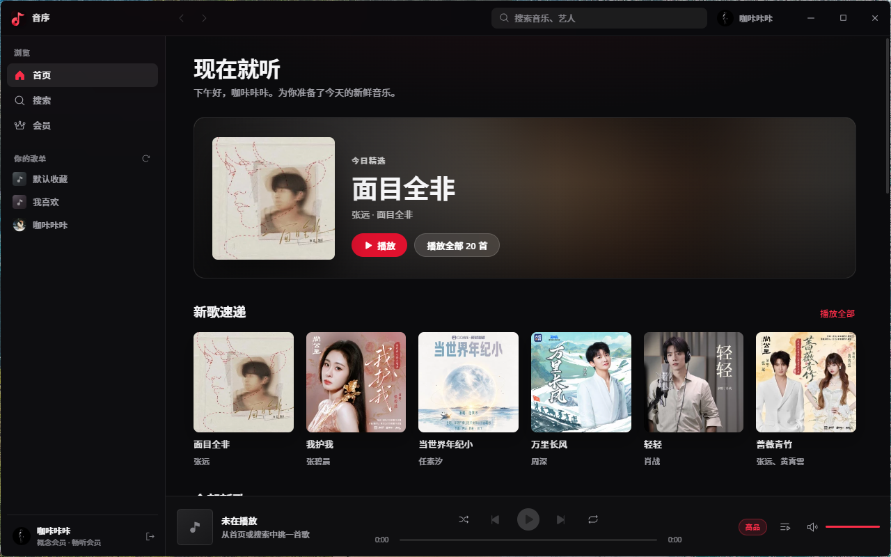
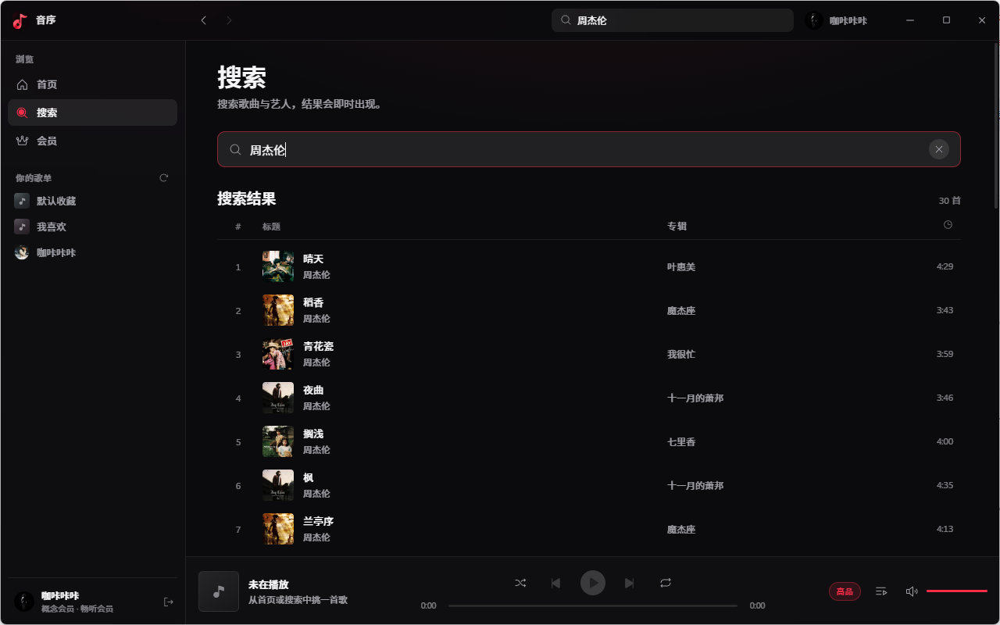
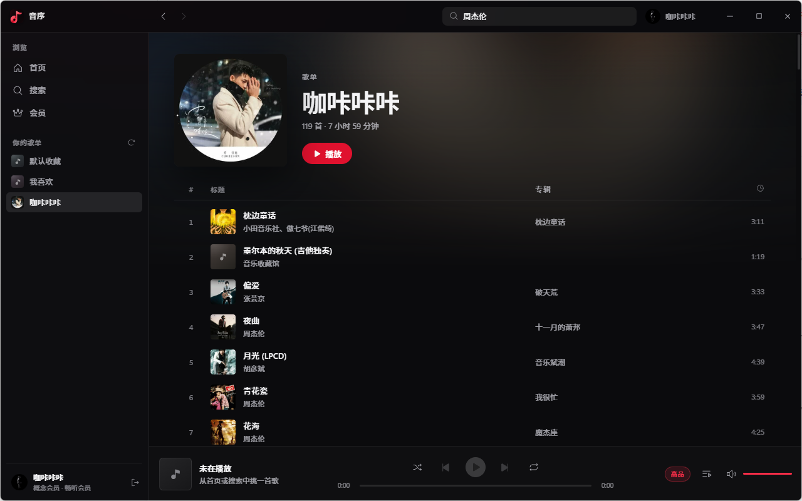
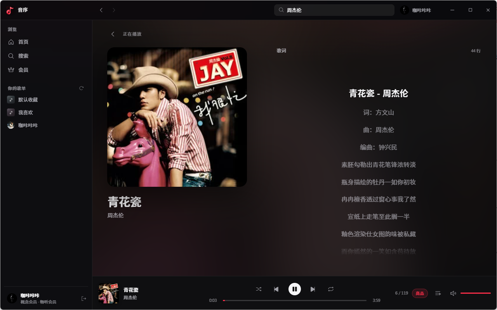

# 音序（Apple Music 风格播放器）

Apple Music 风格的非官方第三方播放器（Electron 桌面 + Capacitor 移动端）。  
接口基于开源 [KuGouMusicApi](https://github.com/MakcRe/KuGouMusicApi)（本仓库 `server/` 目录）。

## 界面预览

> 截图为开发环境演示，账号与歌单为测试数据。









## 环境

- Windows 10/11（桌面开发）
- Node.js 18+（已在 Node 22 验证）
- pnpm 8+
- **Android**：Android Studio（含 Android SDK）打开 `android/`
- **iOS**：必须在 **macOS + Xcode** 打开 `ios/App`（Windows 上只能生成工程，不能编译）

## 安装

```bash
cd D:\project\kugou-player

# 前端 + Electron + Capacitor
pnpm install

# 本地音乐 API
cd server
pnpm install
cd ..
```

若 Electron 下载失败，可先设置镜像再安装：

```powershell
$env:ELECTRON_MIRROR="https://npmmirror.com/mirrors/electron/"
pnpm install
```

## 桌面端启动

一条命令即可（Electron 主进程会自动拉起本地 API，默认端口 **3678**）：

```bash
pnpm dev
```

若窗口已开但搜歌失败，可单独先起 API：

```bash
pnpm server
# 另开终端
pnpm dev
```

## 移动端（Capacitor）

同一套 `src/renderer` 经独立 Vite 构建后，由 Capacitor 包进 Android / iOS。

### 日常命令

```bash
# 构建 Web 资源到 dist-mobile/
pnpm build:mobile

# 同步到 android/、ios/
pnpm cap:sync

# 仅预览 Web（浏览器）
pnpm dev:mobile
```

### 音乐服务地址

客户端已内置云端 API：`https://music.98104.cn`（界面不再提供填写框）。
桌面开发仍可用 `pnpm server` / `pnpm server:lan` 跑本地 API，但默认不会再指向本机。

### Android（Android Studio）

本仓库已包含 `android/` 工程（含明文 HTTP / cleartext，便于连局域网 API）。

1. 安装 [Android Studio](https://developer.android.com/studio)，打开 SDK Manager 装好 Platform SDK 与平台工具
2. **File → Open** 选择本仓库的 `android` 目录（不是仓库根目录）
3. 等待 Gradle 同步完成
4. 连接真机或启动模拟器，点 Run
5. 启动后即可使用（已内置云端 API）

手机端使用独立的顶部栏、底部 Tab、迷你播放器和全屏播放弹层；桌面端的分栏布局不会出现在手机上。系统返回键会优先关闭播放弹层，再从歌单返回资料库。

命令行（需本机已配置 `ANDROID_HOME`）：

```powershell
cd android
.\gradlew.bat assembleDebug
# APK: android\app\build\outputs\apk\debug\app-debug.apk
```

当前若未安装 Android SDK，无法在本机直接出 APK，但不影响用 Android Studio 打开工程。

### iOS（仅 Mac）

本仓库已包含 `ios/` 工程（含 ATS 放行局域网 HTTP）。Windows 上无法编译。

1. 把项目拷到 Mac
2. `cd ios/App` → `pod install`（需 CocoaPods）
3. 用 Xcode 打开 `ios/App/App.xcworkspace`
4. 选模拟器或真机 Run
5. 启动后即可使用（已内置云端 API）

### 已知限制

- 音频为前台播放；Android 使用 MSE + Range 分片流式播放，完整后台播放 / 锁屏控制尚未做
- API 默认指向已部署的云端 KuGouMusicApi（`https://music.98104.cn`）
- iOS 必须在 macOS + Xcode 构建；Windows 只能维护/同步 `ios/` 目录
- 桌面端窗控在移动端已隐藏；窄屏使用底部 Tab 导航

## 已实现功能

- Apple Music 风格深色界面：自绘交通灯标题栏、毛玻璃侧边栏、底部 Now Playing、待播清单
- 登录门禁：必须登录后才能进入主界面，支持手机验证码、账号密码、扫码三种方式
- 首页：今日精选大图、新歌速递、全部新歌（`/top/song`）
- 搜索：输入即搜（防抖）、最近搜索记录、结果歌曲表格（`/search`）
- 资料库：账号信息、我的歌单、歌单详情与一键播放
- 会员：登录后可查看与领取概念版相关权益（逻辑移植自开源项目）
- 播放：请求 `/song/url`（优先试听 `free_part`），HTMLAudio 播放，支持队列、随机、循环、音量
- 启动时 `/register/dev` 注册设备指纹；登录凭证仅保存在本机
- **Android / iOS**：Capacitor 工程已生成，默认使用云端 API

## 如何验证（桌面）

1. `pnpm dev` 打开窗口，会出现登录页
2. 推荐用「验证码」登录（扫码票可能无法同步歌单）
3. 登录后进入「现在就听」，左侧点「搜索」，搜「周杰伦」
4. 点任意歌曲行，底部播放条开始走进度；右侧可打开待播清单、调音量
5. 左侧点「会员」，可查看会员状态

## 三端说明

| 平台 | 方案 |
|------|------|
| Windows | Electron：`pnpm dev` / `pnpm build` |
| Android | Capacitor：`pnpm build:mobile` → `pnpm cap:sync` → Android Studio 打开 `android/` |
| iOS | 同上，但必须在 macOS + Xcode 打开 `ios/App` |

## 免责声明

1. 本项目为**非官方**第三方客户端，与任何音乐平台官方无关。
2. 仅供学习与技术研究，请遵守音乐平台用户协议及当地法律法规。
3. 音乐版权归权利人所有；请支持正版，勿用于商业用途。
4. 使用本软件产生的任何后果由使用者自行承担。

## 技术栈

- Electron + electron-vite + Vue 3 + TypeScript + Pinia + Vue Router
- Capacitor 6（Android / iOS）+ 独立 `vite.config.ts` → `dist-mobile`
- @phosphor-icons/vue 图标，原生 CSS 设计变量（无 UI 框架）
- KuGouMusicApi（`server/`，默认 `platform=lite` 概念版，端口 3678）